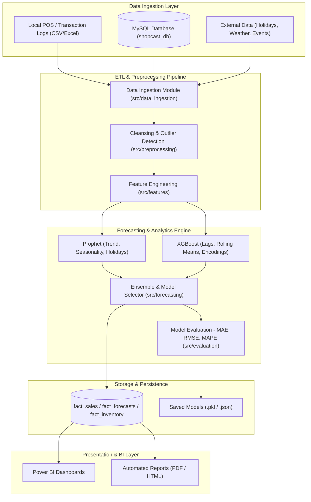
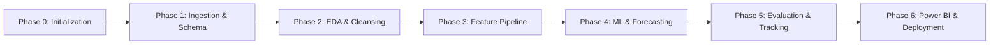

# ShopCast – Project Architecture & Technical Specification

## 1. Project Overview

**ShopCast** is an end-to-end Sales Forecasting and Business Intelligence (BI) platform tailored for local retail shops and small-to-medium retail businesses. Local retailers frequently encounter two critical inventory challenges:

1. **Stockouts**: Running out of fast-moving products during demand surges, resulting in lost revenue and dissatisfied customers.
2. **Overstocking**: Excessive inventory tying up working capital and resulting in shrinkage, spoilage, or steep clearance markdowns.

ShopCast solves these problems by providing automated data ingestion from retail transactional databases, advanced time-series and gradient-boosted forecasting models, and interactive Power BI decision-support dashboards.

---

## 2. Business Objectives

- **Demand Anticipation**: Provide accurate 7-day, 14-day, and 30-day product- and category-level sales forecasts.
- **Inventory Optimization**: Establish dynamic reorder thresholds that minimize carrying costs while maintaining a 98%+ service level.
- **Actionable Business Intelligence**: Deliver executive and operational dashboards highlighting revenue drivers, seasonality patterns, promotional lift, and margin analytics.
- **Operational Efficiency**: Automate repetitive reporting and data pipelines to replace fragmented spreadsheet workflows.

---

## 3. Technology Stack

| Layer | Technology | Version | Purpose |
| :--- | :--- | :--- | :--- |
| **Language** | Python | 3.13+ | Core programming and analytics engine |
| **Relational Database** | MySQL | 8.0+ | Transactional sales, product catalog, and prediction storage |
| **ORM & Connectivity** | SQLAlchemy, PyMySQL | 2.0+, 1.1+ | Type-safe connection pooling and SQL execution |
| **Data Manipulation** | Pandas, NumPy | 2.2+, 2.0+ | Tabular data manipulation, time-series operations |
| **Statistical & ML Models** | Scikit-learn, XGBoost | 1.5+, 2.1+ | Feature-based regression and gradient boosting models |
| **Time-Series Forecasting** | Prophet | 1.5+ | Additive decomposition model capturing seasonality and holidays |
| **Business Intelligence** | Microsoft Power BI | Desktop / Pro | Interactive KPI reporting and executive dashboards |
| **Configuration** | Pydantic Settings, Dotenv | 2.8+, 1.0+ | Typed configuration and 12-factor environment variables |
| **Testing & QA** | Pytest | 8.0+ | Unit and integration test suite |

---

## 4. Proposed System Architecture



---

## 5. Repository Structure

```text
Sales-forecasting-/
│
├── data/
│   ├── raw/                 # Immutable source transaction dumps and external files
│   ├── processed/           # Cleaned, normalized, and feature-engineered datasets
│   └── external/            # Public datasets (calendar holidays, economic indicators)
│
├── database/
│   ├── schema/              # DDL scripts for dimensional and fact tables (schema.sql)
│   ├── queries/             # Standard analytical SQL queries (sample_queries.sql)
│   └── migrations/          # Schema version migration scripts
│
├── notebooks/               # Jupyter exploration and analytical prototyping notebooks
│
├── src/
│   ├── data_ingestion/      # Database extractors and file loaders
│   ├── preprocessing/       # Outlier detection, missing value imputers, formatters
│   ├── analysis/            # Exploratory analysis and statistical summaries
│   ├── features/            # Temporal, lag, window, and holiday feature pipelines
│   ├── forecasting/         # Prophet, XGBoost, and ensemble forecaster classes
│   ├── evaluation/          # Cross-validation, backtesting, and metric computation
│   └── utils/               # Centralized logging, database manager, custom exceptions
│
├── models/                  # Serialized model binaries, scalers, and metadata
├── powerbi/                 # Power BI templates (.pbit), docs, and connection guides
├── reports/                 # Output charts, validation logs, and performance metrics
├── tests/                   # Pytest test suite (unit, integration, structure)
├── docs/                    # Technical architecture, schema docs, setup instructions
├── config/                  # Strongly typed Pydantic application settings
├── requirements.txt         # Pinned production and development dependencies
├── .env.example             # Template for local environment secrets
├── .gitignore               # Strict ignore rules for data, models, and secrets
├── README.md                # Project onboarding and developer guide
└── main.py                  # CLI entrypoint for diagnostics and execution
```

---

## 6. Future Implementation Roadmap



### Phase 1: Data Ingestion & Database Schema
- Establish live MySQL tables according to dimensional modeling standards (`dim_products`, `dim_dates`, `fact_sales`).
- Implement synthetic data generator simulating realistic retail transaction history with seasonality, weekend spikes, and promotions.
- Build batch ETL ingestion scripts.

### Phase 2: Exploratory Data Analysis (EDA) & Preprocessing
- Perform comprehensive statistical profiling on transaction velocity and value distributions.
- Handle missing values, refunds, transaction cancellations, and outlier spikes.
- Create automated EDA reporting notebooks.

### Phase 3: Feature Engineering
- Construct time-lag features ($t-1$, $t-7$, $t-14$, $t-30$).
- Construct rolling-window statistics (7-day and 30-day moving averages, standard deviations).
- Incorporate holiday calendars and promotional flags.

### Phase 4: Model Development & Forecasting
- Baseline forecasting: Rolling naive and exponential smoothing.
- Prophet implementation: Capturing weekly, yearly, and holiday seasonality with changepoint tuning.
- XGBoost implementation: Feature-driven gradient boosted regression with hyperparameter search.
- Hybrid ensemble combining Prophet and XGBoost.

### Phase 5: Model Evaluation & Backtesting
- Implement expanding-window time-series cross-validation.
- Benchmark models with MAE, RMSE, MAPE, and WAPE.
- Persist winning models and write forecasts to `fact_forecasts`.

### Phase 6: Power BI Integration & BI Deployment
- Design interactive Power BI dashboards connecting to MySQL.
- Deploy automated scheduled refresh and inventory alert notifications.

